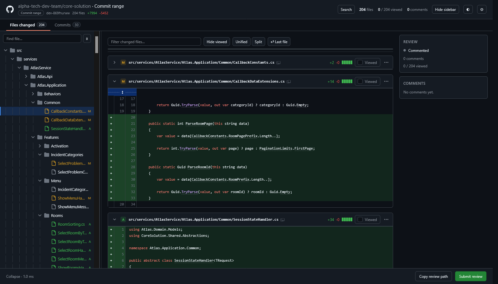

# AI PR Reviewer

**English** · [Русский](docs/README.ru.md) · [Español](docs/README.es.md) · [中文](docs/README.zh.md)

Review code in a real interface: a local page in the style of a GitHub Pull
Request, where you leave comments and from which they go straight to an AI
agent's chat.

Tired of reading `git diff` in a terminal and dictating fixes out loud? Open the
page, drag over lines, write comments, paste screenshots, and press **Request
changes**. The agent picks up your notes and starts fixing code. While it works,
you don't keep a mental list of "what else needs fixing".



## Why this exists

A plain diff in a terminal shows what changed and stops there. It is awkward for
leaving notes, impossible to attach a screenshot to a line, and it can't hand
anything on.

This tool serves an ordinary web page on your machine:

- file tree, syntax highlighting, line numbers;
- drag over a range of lines and comment on it;
- paste a screenshot right into a comment with `Ctrl+V`;
- click a name to jump to its definition, like in an IDE;
- **Viewed** marks files so you don't get lost in a large branch;
- press **Submit review** — pick **Request changes** or **Approve**, and the
  review goes to the agent.

## Submitting a review

One button opens the submit dialog: choose a verdict, write an optional note,
and decide whether to send it to the agent.

| Verdict | What the agent does |
| --- | --- |
| **Request changes** | fixes what the notes and comments say |
| **Approve** | reads the note, confirms the work is accepted, and leaves the code alone |

An approval carries a note too, so "LGTM, but rename that variable later" reaches
the agent without pretending the code needs rewriting. Untick **Send to the AI**
to only save `review.json` / `review.md`.

## What you can review

| Mode | What it shows |
| --- | --- |
| `uncommitted` | what is not committed yet (new files included) |
| `branch` | the whole branch against its base — the default |
| `range` | a chosen range of commits |
| `commits` | specific commits as one change set |
| `all` | the full history of the branch |
| `pr` | a real pull request from GitHub |

The `pr` mode goes through the GitHub CLI. It fetches the needed commits into a
private ref, never touches your branch, and never changes working files.

## Installation

Requires Node.js 20 or newer.

```bash
git clone https://github.com/StayNight-withMe/AI-PR-reviewer.git
cd AI-PR-reviewer
npm install
```

`npm install` also checks for `gh` — if it's missing, it tells you how to
install it. Local reviews don't need it.

## Running

```bash
# review the current branch
npm run review -- .

# uncommitted changes only
npm run review -- . --mode uncommitted

# a pull request from GitHub
npm run review -- . --mode pr --pr 42

# open the browser right away
npm run review -- . --open
```

The console prints an address; open it in your browser.

## Which AI assistants work

There are two independent halves, and only the second one is agent-specific.

**The review page works with any agent.** The page is a local HTTP server, and it
is started by the MCP server, by the `pr-review` CLI, or by any editor
integration. Saving a review always writes `review.json` and `review.md` next to
the artifacts — so Claude Code, Cursor, Gemini CLI, Copilot, Codex or a plain
terminal all get the same result: the agent reads the review file and fixes
accordingly. Untick **Send to the AI** in the submit dialog and point the agent
at that file.

**Auto-dispatch is OpenCode-only.** Pressing **Submit review**, then sending it
to the AI, hands the review straight into the running chat, with no copy-paste.
That works by calling the OpenCode API with the session id of the conversation
that opened the page. Other assistants have no equivalent session API, so for
them the submit saves the files and reports "Review saved. Auto-fix not
started" — the review is never lost, it just doesn't start the turn by itself.

| | Page, comments, artifacts | Auto-dispatch into the chat |
| --- | --- | --- |
| OpenCode | yes | yes |
| Claude Code | yes | no — read `review.md` |
| Cursor, Gemini CLI, Copilot, Codex | yes | no — read `review.md` |
| Plain terminal / human review | yes | not applicable |

So the integration list above is about the editor, not about the agent: the
VS Code extension works with Claude Code just as well as with OpenCode.

## How the AI uses this

If you work in a chat with an agent, you type nothing — just say:

> Look at my uncommitted changes

or

> Open PR #42 from owner/repo and review it

The agent calls the tools itself:

| Tool | What it does |
| --- | --- |
| `list_pull_requests` | lists open PRs so you can pick one |
| `start_review` | opens the review page |
| `await_review` | waits for you to press Submit and collects the notes |
| `get_review` | reads an already saved review |
| `list_review_scope` | lists branches and commits |
| `resolve_comments` | marks notes as fixed |
| `close_review` | closes the page |

## Comments and their state

Every comment has a **Resolve** button — "this is fixed". Resolved comments stay
in place but fade and get struck through, and the header counter shows only open
ones. The agent can do the same thing itself: after a fix it marks the closed
notes.

## Settings

Theme, diff layout, tree width, line wrapping, indentation — everything is
remembered on this machine and survives a new review and a restart.

## Where artifacts live

A review writes `review.json`, `review.md` and images to the system temp
directory, not into the project. The working copy stays clean and you don't need
to touch `.gitignore`. Want another place — set `PR_REVIEW_ARTIFACTS_DIR`.

## Editor integrations

| Editor | How to connect |
| --- | --- |
| VS Code | extension in `editors/vscode` |
| Visual Studio 2022 | plugin in `editors/visualstudio` |
| JetBrains | plugin in `editors/jetbrains` |
| Neovim | Lua module in `editors/neovim` |
| Sublime Text | plugin in `editors/sublime` |
| Emacs | package in `editors/emacs` |
| Zed | MCP server + task, `editors/zed` |
| Helix | pipe command + MCP, `editors/helix` |

Details are in `editors/README.md`. Every integration is a thin wrapper over one
engine, `src/cli.js`.

## Development

```bash
npm test                 # unit tests
npm run test:pr          # PR mode offline, no network
npm run test:pr:ui       # PR page in a browser
npm run test:all         # everything
```

The PR-mode tests run against a fake `gh` and a local repository, so they need
neither a network nor a GitHub account.

## Project layout

```
src/
  config.js          every constant: routes, git arguments, UI sizes
  cli.js             launcher that editors run
  index.js           MCP server and its tools
  core.js            builds a review: scope -> diff -> page
  github.js          pull requests through gh
  git.js             git access
  diff.js            unified diff parser
  render.js          page HTML and Markdown export
  server.js          HTTP server for the page
  settings-store.js  UI settings
  artifacts.js       artifact paths
  assets/            client-side page code
  models/            data models: scope, tree, diffs, commits
```

Project rule: no magic literals in code — everything lives in `config.js`, with
client copies in `assets/constants.js`.

## License

MIT. Do what you want, just don't complain if something breaks.
