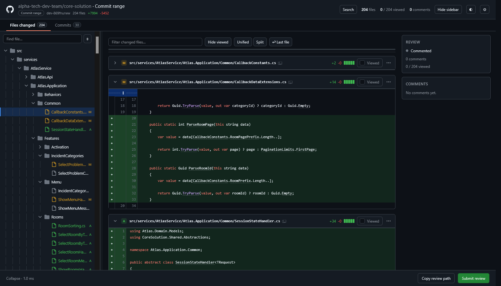

# AI PR Reviewer

[English](../README.md) · [Русский](README.ru.md) · **Español** · [中文](README.zh.md)

Revisa código en una interfaz de verdad: una página local con el estilo de un
Pull Request de GitHub, donde dejas comentarios y desde la que se envían
directamente al chat de un agente de IA.

¿Cansado de leer `git diff` en la terminal y dictar correcciones en voz alta?
Abre la página, arrastra sobre las líneas, escribe comentarios, pega capturas y
pulsa **Request changes**. El agente recoge tus notas y empieza a corregir el
código. Mientras trabaja, no tienes que recordar "qué más falta por arreglar".



## Para qué sirve

Un diff normal en la terminal muestra qué cambió y ahí se acaba. Es incómodo para
dejar notas, no permite adjuntar una captura a una línea y no puede pasar nada
hacia adelante.

Esta herramienta levanta una página web normal en tu máquina:

- árbol de archivos, resaltado de sintaxis, números de línea;
- arrastra sobre un rango de líneas y coméntalo;
- pega una captura directamente en un comentario con `Ctrl+V`;
- haz clic en un nombre para ir a su definición, como en un IDE;
- **Viewed** marca archivos para no perderte en una rama grande;
- pulsa **Request changes** — la revisión va al agente y empieza a corregir.

## Qué puedes revisar

| Modo | Qué muestra |
| --- | --- |
| `uncommitted` | lo que aún no está confirmado (incluidos archivos nuevos) |
| `branch` | la rama completa contra su base — por defecto |
| `range` | un rango de commits elegido |
| `commits` | commits concretos como un único conjunto de cambios |
| `all` | toda la historia de la rama |
| `pr` | un pull request real de GitHub |

El modo `pr` funciona con la GitHub CLI. Descarga los commits necesarios a una
referencia privada, nunca toca tu rama y no modifica archivos de trabajo.

## Instalación

Necesitas Node.js 20 o superior.

```bash
git clone https://github.com/StayNight-withMe/AI-PR-reviewer.git
cd AI-PR-reviewer
npm install
```

`npm install` también comprueba si existe `gh`; si falta, te dice cómo
instalarlo. Las revisiones locales no lo necesitan.

## Ejecución

```bash
# revisar la rama actual
npm run review -- .

# solo lo no confirmado
npm run review -- . --mode uncommitted

# un pull request de GitHub
npm run review -- . --mode pr --pr 42

# abrir el navegador directamente
npm run review -- . --open
```

La consola muestra una dirección; ábrela en el navegador.

## Con qué asistentes de IA funciona

Hay dos mitades independientes, y solo la segunda depende de un agente concreto.

**La página de revisión funciona con cualquier agente.** La página es un servidor
HTTP local, lo levanta el servidor MCP, el CLI `pr-review` o cualquier integración
de editor. Al enviar, siempre se escriben `review.json` y `review.md` junto a los
artefactos, así que Claude Code, Cursor, Gemini CLI, Copilot, Codex o una simple
terminal obtienen lo mismo: el agente lee el archivo de revisión y corrige según
él. En el diálogo de envío elige «solo la ruta de la revisión» y pásale ese
archivo al agente.

**El envío automático al chat es solo de OpenCode.** Pulsar **Request changes** y
luego **Send to the AI** entrega la revisión directamente en la conversación
abierta, sin copiar y pegar. Funciona llamando a la API de OpenCode con el
identificador de la sesión desde la que se abrió la página. Otros asistentes no
tienen una API de sesiones equivalente, así que en ellos el envío guarda los
archivos y avisa «Review saved. Auto-fix not started»: la revisión no se pierde,
simplemente no inicia el turno por sí sola.

| | Página, comentarios, artefactos | Envío automático al chat |
| --- | --- | --- |
| OpenCode | sí | sí |
| Claude Code | sí | no — leer `review.md` |
| Cursor, Gemini CLI, Copilot, Codex | sí | no — leer `review.md` |
| Terminal / revisión manual | sí | no aplica |

O sea, la lista de integraciones de arriba es sobre el editor, no sobre el
agente: la extensión de VS Code funciona igual con Claude Code que con OpenCode.

## Cómo lo usa la IA

Si trabajas en un chat con un agente, no escribes nada: solo di

> Mira mis cambios sin confirmar

o

> Abre el PR #42 de owner/repo y revísalo

El agente llama a las herramientas por sí mismo:

| Herramienta | Qué hace |
| --- | --- |
| `list_pull_requests` | lista los PR abiertos para elegir uno |
| `start_review` | abre la página de revisión |
| `await_review` | espera a que pulses Submit y recoge las notas |
| `get_review` | lee una revisión ya guardada |
| `list_review_scope` | lista ramas y commits |
| `resolve_comments` | marca notas como corregidas |
| `close_review` | cierra la página |

## Comentarios y su estado

Cada comentario tiene un botón **Resolve**: "esto ya está corregido". Los
comentarios resueltos siguen en su sitio pero se atenúan y se tachan, y el
contador de la cabecera muestra solo los abiertos. El agente puede hacer lo mismo
por su cuenta: después de corregir, marca las notas cerradas.

## Ajustes

Tema, diseño del diff, ancho del árbol, ajuste de línea, sangría: todo se
recuerda en este equipo y sobrevive a una nueva revisión y a un reinicio.

## Dónde viven los artefactos

Una revisión escribe `review.json`, `review.md` e imágenes en la carpeta temporal
del sistema, no en el proyecto. La copia de trabajo queda limpia y no hace falta
tocar `.gitignore`. Si quieres otro sitio, define `PR_REVIEW_ARTIFACTS_DIR`.

## Integraciones con editores

| Editor | Cómo conectarlo |
| --- | --- |
| VS Code | extensión en `editors/vscode` |
| Visual Studio 2022 | plugin en `editors/visualstudio` |
| JetBrains | plugin en `editors/jetbrains` |
| Neovim | módulo Lua en `editors/neovim` |
| Sublime Text | plugin en `editors/sublime` |
| Emacs | paquete en `editors/emacs` |
| Zed | servidor MCP + tarea, `editors/zed` |
| Helix | comando pipe + MCP, `editors/helix` |

Los detalles están en `editors/README.md`. Cada integración es una capa fina
sobre un único motor, `src/cli.js`.

## Desarrollo

```bash
npm test                 # pruebas unitarias
npm run test:pr          # modo PR sin conexión
npm run test:pr:ui       # página del PR en un navegador
npm run test:all         # todo
```

Las pruebas del modo PR funcionan con un `gh` falso y un repositorio local, así
que no necesitan ni red ni cuenta de GitHub.

## Estructura del proyecto

```
src/
  config.js          todas las constantes: rutas, argumentos de git, tamaños de UI
  cli.js             lanzador que ejecutan los editores
  index.js           servidor MCP y sus herramientas
  core.js            arma una revisión: scope -> diff -> página
  github.js          pull requests a través de gh
  git.js             acceso a git
  diff.js            analizador de unified diff
  render.js          HTML de la página y exportación a Markdown
  server.js          servidor HTTP de la página
  settings-store.js  ajustes de la interfaz
  artifacts.js       rutas de los artefactos
  assets/            código del cliente
  models/            modelos de datos: scope, árbol, diffs, commits
```

Regla del proyecto: nada de literales mágicos en el código, todo vive en
`config.js`, con copias para el cliente en `assets/constants.js`.

## Licencia

MIT. Haz lo que quieras, solo no te quejes si algo se rompe.
