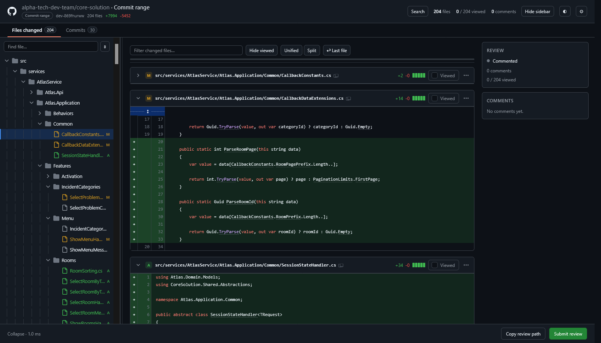

# AI PR Reviewer

[English](../README.md) · **Русский** · [Español](README.es.md) · [中文](README.zh.md)

Ревью кода с удобным интерфейсом: локальная страница в стиле GitHub Pull
Request, куда можно писать замечания, и откуда они сразу уходят в чат с
ИИ-агентом.

Устал читать `git diff` в терминале и диктовать правки голосом? Здесь ты
открываешь страницу, мышкой выделяешь строки, пишешь комментарии, вставляешь
скриншоты — и жмёшь **Request changes**. Нейросеть забирает твои замечания и
садится править код. Пока она работает, ты не держишь в голове список «что ещё
надо поправить».



## Зачем это нужно

Обычный diff в терминале показывает, что изменилось, и на этом всё. В нём
неудобно оставлять замечания, невозможно приложить скриншот к строке, и он
ничего не умеет передавать дальше.

Эта утилита поднимает на твоей машине обычную веб-страницу:

- дерево файлов, подсветка синтаксиса, номера строк;
- выделяешь диапазон строк мышкой и пишешь к нему комментарий;
- скриншот вставляешь прямо в комментарий через `Ctrl+V`;
- кликаешь по имени — переходишь к его определению, как в IDE;
- **Viewed** отмечает файлы, чтобы не потеряться в большой ветке;
- нажимаешь **Request changes** — ревью уходит агенту, и он начинает правки.

## Что можно ревьюить

| Режим | Что показывает |
| --- | --- |
| `uncommitted` | то, что ещё не закоммичено (включая новые файлы) |
| `branch` | всю ветку против базовой — по умолчанию |
| `range` | выбранный диапазон коммитов |
| `commits` | конкретные коммиты одним набором изменений |
| `all` | всю историю ветки |
| `pr` | настоящий пул-реквест с GitHub |

Режим `pr` — через GitHub CLI. Он сам скачает нужные коммиты в служебную
ссылку, твою ветку не тронет и рабочие файлы не изменит.

## Установка

Нужен Node.js 20 или новее.

```bash
git clone https://github.com/StayNight-withMe/AI-PR-reviewer.git
cd AI-PR-reviewer
npm install
```

`npm install` заодно проверит наличие `gh` — если его нет, просто подскажет, как
поставить. Для локальных ревью он не нужен.

## Запуск

```bash
# ревью текущей ветки
npm run review -- .

# только незакоммиченное
npm run review -- . --mode uncommitted

# пул-реквест с GitHub
npm run review -- . --mode pr --pr 42

# сразу открыть браузер
npm run review -- . --open
```

В консоли появится адрес, открывай его в браузере.

## С какими ИИ это работает

Здесь две независимые половины, и только вторая завязана на конкретного агента.

**Страница ревью работает с любым агентом.** Страница — это локальный
HTTP-сервер, его поднимает MCP-сервер, CLI `pr-review` или интеграция с
редактором. По submit всегда пишутся `review.json` и `review.md` рядом с
артефактами, поэтому Claude Code, Cursor, Gemini CLI, Copilot, Codex или
обычный терминал получают одно и то же: агент читает файл ревью и правит по
нему. В окне отправки выбери «только путь к ревью» и передай агенту этот файл.

**Автоотправка в чат есть только у OpenCode.** Кнопка **Request changes**, затем
**Send to the AI**, передаёт ревью прямо в открытый чат, без копирования. Это
работает через API OpenCode по идентификатору сессии, из которой открыли
страницу. У других ассистентов такого API сессий нет, поэтому у них submit
сохраняет файлы и пишет «Review saved. Auto-fix not started» — ревью не
теряется, просто ход не стартует сам.

| | Страница, комментарии, артефакты | Автоотправка в чат |
| --- | --- | --- |
| OpenCode | да | да |
| Claude Code | да | нет — читать `review.md` |
| Cursor, Gemini CLI, Copilot, Codex | да | нет — читать `review.md` |
| Терминал / ревью глазами | да | не применимо |

То есть список интеграций выше — про редактор, а не про агента: расширение
VS Code одинаково работает и с Claude Code, и с OpenCode.

## Как этим пользуется ИИ

Если ты работаешь в чате с агентом, ничего вводить не надо — просто скажи:

> Посмотри мои незакоммиченные изменения

или

> Открой PR #42 из owner/repo и проверь его

Агент сам вызовет нужные инструменты:

| Инструмент | Что делает |
| --- | --- |
| `list_pull_requests` | показывает открытые PR, чтобы выбрать |
| `start_review` | открывает страницу ревью |
| `await_review` | ждёт, пока ты нажмёшь Submit, и забирает замечания |
| `get_review` | читает уже сохранённое ревью |
| `list_review_scope` | показывает ветки и коммиты |
| `resolve_comments` | отмечает замечания исправленными |
| `close_review` | закрывает страницу |

## Замечания и их статус

У каждого комментария есть **Resolve** — «это уже исправлено». Решённые
комментарии остаются на месте, но гаснут и перечёркиваются, а счётчик в шапке
показывает только открытые. Агент может делать то же самое сам: после правки он
отмечает закрытые замечания.

## Настройки

Тема, раскладка diff, ширина дерева, перенос строк, отступы — всё запоминается
на этом компьютере и переживает новое ревью и перезапуск.

## Где лежат артефакты

Ревью складывает `review.json`, `review.md` и картинки во временную папку
системы, а не в проект. Рабочая копия остаётся чистой, `.gitignore` править не
надо. Хочешь другое место — задай `PR_REVIEW_ARTIFACTS_DIR`.

## Интеграции с редакторами

| Редактор | Как подключить |
| --- | --- |
| VS Code | расширение в `editors/vscode` |
| Visual Studio 2022 | плагин в `editors/visualstudio` |
| JetBrains | плагин в `editors/jetbrains` |
| Neovim | Lua-модуль в `editors/neovim` |
| Sublime Text | плагин в `editors/sublime` |
| Emacs | пакет в `editors/emacs` |
| Zed | MCP-сервер + task, `editors/zed` |
| Helix | pipe-команда + MCP, `editors/helix` |

Подробности — в `editors/README.md`. Все интеграции — тонкие обёртки над одним
движком `src/cli.js`.

## Разработка

```bash
npm test                 # юнит-тесты
npm run test:pr          # PR-режим офлайн, без сети
npm run test:pr:ui       # PR-страница в браузере
npm run test:all         # всё
```

Тесты для PR-режима работают на поддельном `gh` и локальном репозитории, так что
им не нужны ни сеть, ни аккаунт GitHub.

## Устройство проекта

```
src/
  config.js          все константы: маршруты, аргументы git, размеры UI
  cli.js             лаунчер, который запускают редакторы
  index.js           MCP-сервер и его инструменты
  core.js            сборка ревью: scope -> diff -> страница
  github.js          пул-реквесты через gh
  git.js             работа с git
  diff.js            разбор unified diff
  render.js          HTML страницы и Markdown-экспорт
  server.js          HTTP-сервер страницы
  settings-store.js  настройки интерфейса
  artifacts.js       пути к артефактам
  assets/            клиентский код страницы
  models/            модели данных: scope, дерево, диффы, коммиты
```

Правило проекта: никаких магических литералов в коде — всё в `config.js`, а
клиентские дубликаты в `assets/constants.js`.

## Лицензия

MIT. Делай что хочешь, только не жалуйся, если что-то сломается.
