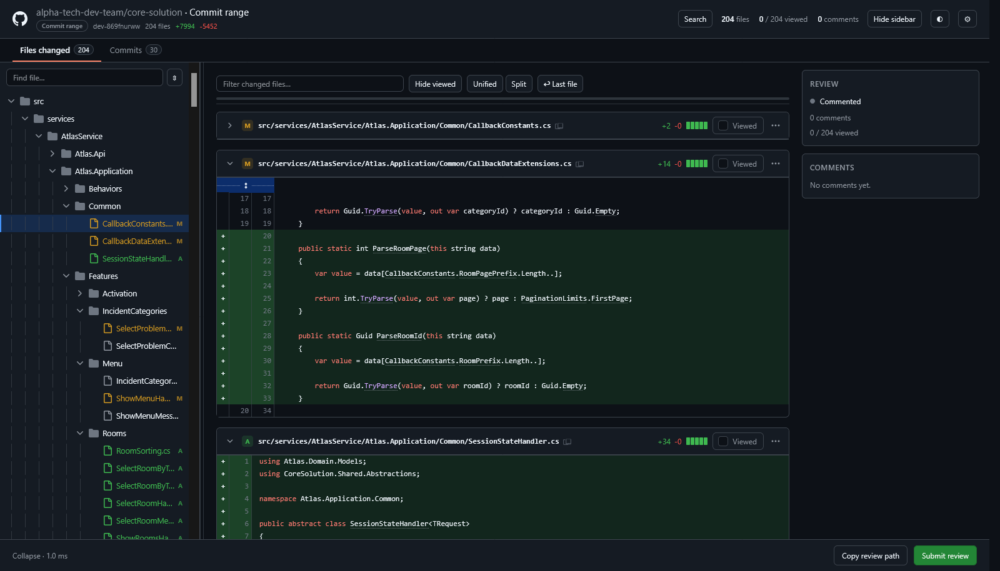

# AI PR Reviewer

[English](../README.md) · [Русский](README.ru.md) · [Español](README.es.md) · **中文**

用真正的界面来审查代码：一个本地页面，外观和 GitHub Pull Request 一样。你在这里写批注，批注会直接送到 AI 助手的对话里。

受够在终端里读 `git diff`、再用嘴念修改意见了吗？打开页面，拖动鼠标选中行，写下批注，粘贴截图，然后按 **Request changes**。AI 会接手你的批注并开始改代码。在它工作的时候，你不需要在脑子里记着"还有哪里要改"。



## 为什么需要它

终端里的 diff 只告诉你改了什么，到此为止。写批注很别扭，没法给某一行附截图，也没法把结果交给别人。

这个工具会在你的电脑上起一个普通的网页：

- 文件树、语法高亮、行号；
- 拖动选中一段行，就着它写批注；
- 用 `Ctrl+V` 把截图直接贴进批注；
- 点击名字跳到定义，和 IDE 一样；
- **Viewed** 标记文件，大分支里不会走丢；
- 按 **Request changes**，审查交给 AI，它开始修改。

## 可以审查什么

| 模式 | 显示内容 |
| --- | --- |
| `uncommitted` | 还没提交的内容（包括新文件） |
| `branch` | 整条分支对比基线——默认 |
| `range` | 选定的一段提交 |
| `commits` | 指定的几个提交，合成一组改动 |
| `all` | 分支的完整历史 |
| `pr` | GitHub 上真实的 pull request |

`pr` 模式通过 GitHub CLI 工作。它把需要的提交抓到一条私有引用里，不动你的分支，也不改工作区文件。

## 安装

需要 Node.js 20 或更新版本。

```bash
git clone https://github.com/StayNight-withMe/AI-PR-reviewer.git
cd AI-PR-reviewer
npm install
```

`npm install` 会顺便检查有没有 `gh`；没有的话会提示怎么装。本地审查用不到它。

## 运行

```bash
# 审查当前分支
npm run review -- .

# 只看未提交的改动
npm run review -- . --mode uncommitted

# GitHub 上的 pull request
npm run review -- . --mode pr --pr 42

# 顺便打开浏览器
npm run review -- . --open
```

控制台会打印一个地址，在浏览器里打开它。

## 支持哪些 AI 助手

这里有两块互相独立的部分，只有第二块和具体的助手有关。

**审查页面适用于任何助手。** 页面是一个本地 HTTP 服务器，由 MCP 服务器、`pr-review` CLI 或任意编辑器集成启动。提交时总会把 `review.json` 和 `review.md` 写到产物目录里，所以 Claude Code、Cursor、Gemini CLI、Copilot、Codex 或者普通终端拿到的结果都一样：助手读取审查文件，照着改。在提交对话框里选"只给我审查路径"，再把这个文件交给助手。

**自动发送到对话只有 OpenCode 支持。** 按 **Request changes**，再选 **Send to the AI**，审查会直接进入打开的那个对话，不用复制粘贴。它通过 OpenCode 的 API 和打开页面时的会话 ID 来工作。其他助手没有等价的会话 API，所以在它们那里提交会保存文件并提示 "Review saved. Auto-fix not started"——审查不会丢，只是不会自动开始那一轮。

| | 页面、批注、产物 | 自动发送到对话 |
| --- | --- | --- |
| OpenCode | 支持 | 支持 |
| Claude Code | 支持 | 不支持——读 `review.md` |
| Cursor、Gemini CLI、Copilot、Codex | 支持 | 不支持——读 `review.md` |
| 终端 / 人工审查 | 支持 | 不适用 |

也就是说，上面那个集成列表说的是编辑器，不是助手：VS Code 扩展配 Claude Code 和配 OpenCode 一样能用。

## AI 怎么用它

如果你在对话里和助手协作，什么都不用输，直接说：

> 看看我还没提交的改动

或者

> 打开 owner/repo 的 PR #42，审查一下

助手会自己调用对应的工具：

| 工具 | 做什么 |
| --- | --- |
| `list_pull_requests` | 列出打开的 PR，方便挑选 |
| `start_review` | 打开审查页面 |
| `await_review` | 等你按 Submit，然后取走批注 |
| `get_review` | 读取已保存的审查 |
| `list_review_scope` | 列出分支和提交 |
| `resolve_comments` | 把批注标记为已修复 |
| `close_review` | 关闭页面 |

## 批注及其状态

每条批注都有 **Resolve** 按钮，意思是"这条已经修好了"。已解决的批注留在原地，但会变淡并加上删除线，页头的计数只显示未解决的。AI 也能自己做这件事：改完之后标记已关闭的批注。

## 设置

主题、diff 布局、文件树宽度、自动换行、缩进——全部记在这台电脑上，新的一次审查和重启都不会丢。

## 产物放在哪里

审查会把 `review.json`、`review.md` 和图片写进系统的临时目录，不写进项目。工作副本保持干净，也不用改 `.gitignore`。想换个地方，设置 `PR_REVIEW_ARTIFACTS_DIR`。

## 编辑器集成

| 编辑器 | 怎么接 |
| --- | --- |
| VS Code | `editors/vscode` 里的扩展 |
| Visual Studio 2022 | `editors/visualstudio` 里的插件 |
| JetBrains | `editors/jetbrains` 里的插件 |
| Neovim | `editors/neovim` 里的 Lua 模块 |
| Sublime Text | `editors/sublime` 里的插件 |
| Emacs | `editors/emacs` 里的包 |
| Zed | MCP 服务器 + task，`editors/zed` |
| Helix | pipe 命令 + MCP，`editors/helix` |

细节在 `editors/README.md`。每个集成都只是同一个引擎 `src/cli.js` 外面的一层薄壳。

## 开发

```bash
npm test                 # 单元测试
npm run test:pr          # PR 模式，离线
npm run test:pr:ui       # 浏览器里的 PR 页面
npm run test:all         # 全部
```

PR 模式的测试跑在假的 `gh` 和本地仓库上，不需要网络，也不需要 GitHub 账号。

## 项目结构

```
src/
  config.js          所有常量：路由、git 参数、UI 尺寸
  cli.js             编辑器调用的启动器
  index.js           MCP 服务器和它的工具
  core.js            组装审查：scope -> diff -> 页面
  github.js          通过 gh 处理 pull request
  git.js             git 访问
  diff.js            unified diff 解析
  render.js          页面 HTML 和 Markdown 导出
  server.js          页面的 HTTP 服务器
  settings-store.js  界面设置
  artifacts.js       产物路径
  assets/            页面客户端代码
  models/            数据模型：scope、文件树、diff、提交
```

项目规矩：代码里不写魔法字面量，全部放在 `config.js`，客户端的副本放在 `assets/constants.js`。

## 许可证

MIT。想怎么用都行，只是出问题别抱怨。
